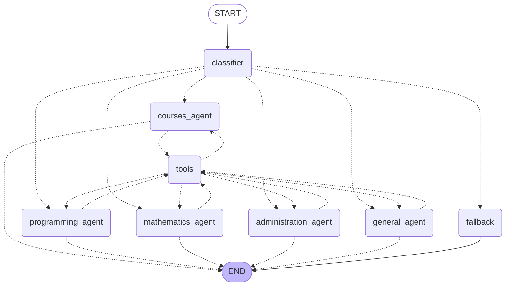

# Report — Building AI Agents with LangGraph

Course: Advanced Artificial Intelligence / Generative AI
Lab: Practical Lab — Building AI Agents with LangGraph
Files: `langgraph_lab.ipynb`, `src/university_assistant.py`, `diagrams/`

## 1. From LLM chains to agentic workflows

A conventional LLM chain is a fixed, linear pipeline: *prompt → model → parser*, possibly
repeated a few times. Its control flow is decided by the developer at design time. An
**agentic workflow** lets the model take part in the control flow at run time: it decides
which branch to follow, whether to call a tool, and whether it is done. This requires loops
(agent → tool → agent), a shared state that survives between steps and, for conversations,
persistence between calls. LangGraph provides exactly these primitives.

## 2. Answers to the conceptual questions

### 2.1 Role of LangChain, LangGraph and the LLM (Exercise 1)

- **LangChain** supplies the standard building blocks of an LLM application: model
  wrappers (`ChatOpenAI`), message types, prompt templates, output parsers, tool definitions
  (`@tool`) and integrations. It lets us compose model calls into chains without depending on
  one provider's SDK.
- **LangGraph** is the orchestration layer built on top of LangChain. It describes an
  application as a stateful graph: a typed state, nodes that update it, normal and
  conditional edges that define the control flow, cycles, and checkpointers for persistence.
  It is what turns a model into an agent that chooses its next action.
- **An LLM** is a transformer network trained to predict the next token on a very large
  corpus and then aligned to follow instructions. Inside the graph it is the reasoning
  engine: it classifies, generates answers and, when tools are bound to it, emits structured
  tool calls. The model is stateless; the graph owns state, memory and control flow.

### 2.2 Nodes, edges, START, END and state (Exercise 2)

1. **Node**: a unit of computation, a Python function (or Runnable) that receives the
   current state and returns a partial update (`{"response": ...}`).
2. **Edge**: a directed link saying which node runs next. Normal edges are fixed;
   conditional edges call a routing function on the state and use its return value to pick
   the next node. Edges may form loops.
3. **`START`**: the virtual entry node. The edge leaving it says which node receives the
   input given to `invoke()`.
4. **`END`**: the virtual terminal node. Reaching it stops the run and returns the final
   state.
5. **Why the state is passed between nodes**: nodes are stateless, so the shared state is
   their only communication channel. This makes the data flow explicit and typed, allows
   reducers such as `add_messages` to accumulate values instead of overwriting them, and
   makes a run inspectable, checkpointable (memory, resume) and parallelisable.

### 2.3 Router evaluation (Part IX)

The six test questions are unambiguous, and the router built with a free instruction-tuned
model (`nvidia/nemotron-3-ultra-550b-a55b:free` served through OpenRouter) at temperature 0
scored **6/6 (100 %)** in our run. Latency varied from 5 s to 128 s per question, because
the free reasoning model is slow and requests are sometimes re-routed to a fallback model
when the provider is overloaded.
Routers of this kind fail mostly on **ambiguous questions** ("implement gradient descent in
Python" is both programming and AI) and on **formatting drift** (the model answers
"Category: Mathematics." or "math" instead of the bare label). Lower-casing and substring
matching with a default branch already absorb the second problem, but "math" would still
fall into the fallback.

Ways to make routing more robust:

- **Structured output with enum validation**: `llm.with_structured_output()` on a Pydantic
  model whose field is a `Literal[...]` of the allowed labels. Function calling guarantees a
  valid label, so parsing cannot fail.
- **Few-shot examples** in the classification prompt, including borderline cases, and
  explicit tie-breaking rules ("if code is requested, choose programming").
- **Validation and retry**: if the label is invalid, re-ask once with a stricter prompt
  before falling back.
- **A larger labelled test set** with accuracy, a confusion matrix, latency and cost per
  category so prompt changes can be compared objectively.
- For high volume, a small **fine-tuned classifier** or embeddings with nearest-centroid,
  which is cheaper and deterministic.

## 3. Capstone: Intelligent University Assistant

### 3.1 Architecture

Dotted arrows are conditional edges. The exact Mermaid source exported from the compiled
graph is in `diagrams/assistant.mmd`.

### 3.2 How the requirements are met

| Requirement | Implementation |
|---|---|
| Question classifier | `classify` node: one LLM call returns COURSES / PROGRAMMING / MATHEMATICS / ADMINISTRATION / GENERAL |
| Specialised agents | one node per category, created by the `make_agent` factory with a dedicated system prompt |
| Memory | `MemorySaver` checkpointer; each conversation is a `thread_id`; messages accumulate through the `add_messages` reducer |
| Tools | `calculator` (safe, `ast`-based) and `current_datetime`, bound to the model with `bind_tools`, executed by a `ToolNode` |
| Conditional routing | `route_after_classifier` (category → agent), `route_after_agent` (tool call? → tools or END), `route_after_tools` (back to the same agent) |
| Error handling | empty input → `fallback`; unknown label → GENERAL; API exceptions caught in the classifier and the agents; `handle_tool_errors=True` turns bad tool calls into recoverable messages |

### 3.3 Design choices

- **Model and provider.** The model is a free one served through OpenRouter, an
  OpenAI-compatible gateway. `ChatOpenAI` from `langchain-openai` is reused with a different
  `base_url`, so the whole lab runs without a paid API and the provider can be swapped by
  changing one cell. The model must support tool calling; `nvidia/nemotron-3-ultra-550b-a55b:free`
  (550B-parameter MoE, built for agent orchestration) is the default and three lighter
  alternatives are passed in OpenRouter's `models` parameter, so a request that fails
  because the provider is overloaded or rate-limited is retried on the next model
  automatically. During our runs Nemotron returned `503 provider_overloaded` several
  times, which is why this fallback and the `try/except` blocks in the nodes matter.
- **One agent per category** rather than one generic prompt: each prompt can carry its own
  rules (the mathematics tutor must use the calculator, the administration assistant must
  never invent official deadlines). Adding a category is one entry in two dictionaries.
- **The model decides when to use a tool.** The graph only checks whether the last message
  contains tool calls. This keeps the routing code small and lets the same mechanism serve
  every tool added later (Wikipedia, web search, database).
- **Return to the same agent after a tool call**, so the final answer is written with the
  right persona and the full context, including the tool result.
- **Safe calculator.** The original lab used `eval()`, which executes arbitrary Python. The
  `ast`-based version only accepts numbers and arithmetic operators;
  `__import__('os')` returns "Invalid expression".
- **Memory per thread.** The checkpointer makes the assistant remember the student's name in
  one thread while another thread knows nothing about it, which is the behaviour expected of
  a multi-user assistant.

### 3.4 Demonstration

The notebook runs six queries that cover every category, both tools and the empty-input
error case, then a memory test (two calls on the same `thread_id`) and a full trace of a
calculator call showing the `AIMessage` with the tool call, the `ToolMessage` with the result
and the final answer. The same scenario is available from the command line with
`python src/university_assistant.py --demo`.

## 4. Possible extensions

Wikipedia or web search tools for course content, a SQLite database with the real course
catalogue and administrative deadlines for the COURSES and ADMINISTRATION agents, structured
output for the classifier, a persistent checkpointer (SQLite/Postgres) instead of the
in-memory one, and streaming of the agents' answers in a chat interface.
